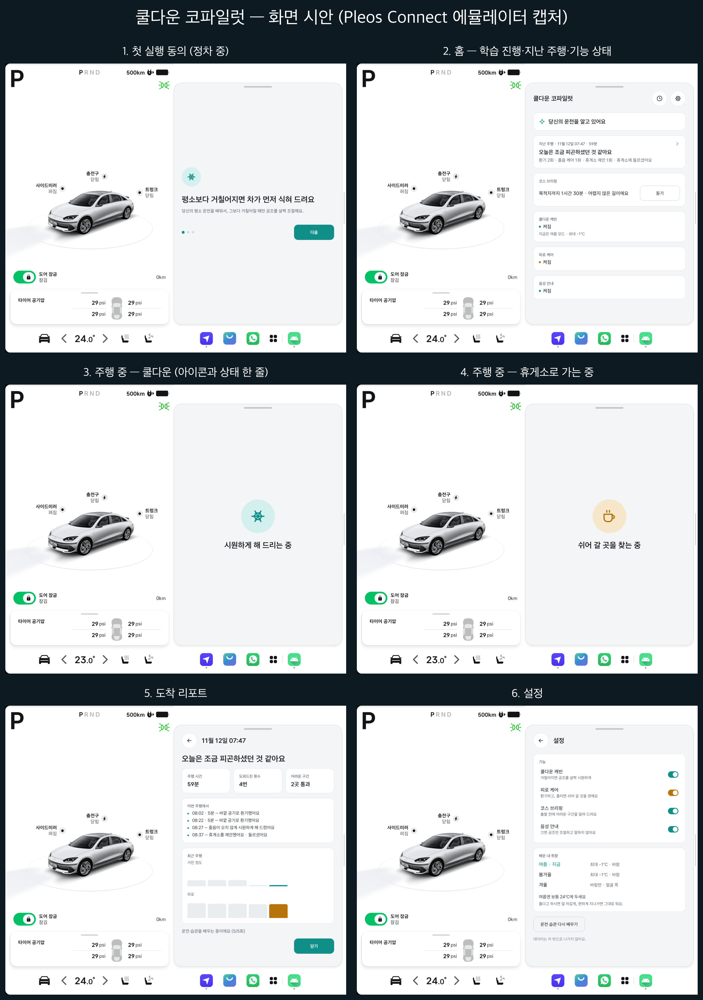
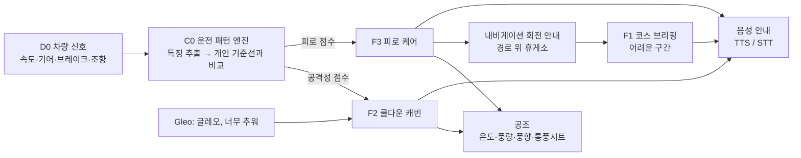

# 쿨다운 코파일럿 (Cooldown Copilot)

> 평소 운전 습관을 학습한 AI가 운전이 거칠어지면 실내를 시원하게 식혀 주고, 졸음은 환기로 예방하고 조향 패턴으로 감지해 휴게소에서 실제로 쉬어 가도록 돕는 차량용 코파일럿입니다.

Pleos Connect(AAOS 기반) 차량용 앱으로, 현대자동차그룹 차량용 앱 개발 공모전 출품작입니다.

## 심사 안내

### 제출 APK
| 파일 | 설명 |
|---|---|
| [`apk/CoolDownTeam_CooldownCopilot_release.apk`](apk/CoolDownTeam_CooldownCopilot_release.apk) | **제출본.** release 빌드 (release 키 서명, 버전 1.1) |
| [Release v1.1](https://github.com/CoolDownTeam/cooldown-copilot/releases/tag/v1.1) | 제출본과 같은 APK, 시연 영상 2편, 화면 시안 |

### 시연 영상 (각 약 4분)
- [자막판](https://github.com/CoolDownTeam/cooldown-copilot/releases/download/v1.1/CoolDownCopilot_demo.mp4): 쿨다운 캐빈, 코스 브리핑, 피로 케어, 주행 리포트, 설정을 기능별로 소개합니다.
- [명령 화면판](https://github.com/CoolDownTeam/cooldown-copilot/releases/download/v1.1/CoolDownCopilot_demo_commands.mp4): 같은 장면에 실제로 실행한 `adb` 명령과 앱 로그를 함께 보여 줍니다.



### 테스트 환경
- macOS(Apple Silicon), Android Studio, **Pleos Connect Emulator** AVD `Pleos_Connect_v2.0` (AAOS, Android 14 기반)
- Pleos SDK: Vehicle·NaviHelper 2.0.3, TextToSpeech·SpeechToText 3.3.1
- 앱은 차량의 운전자 프로필(Android 사용자 10)에서 실행됩니다. 따라서 `adb` 명령에는 `--user 10` 또는 `--user current` 옵션이 필요합니다.

### 사전 설정
- **첫 실행 동의를 먼저 완료해야 합니다.** 동의 3단계를 마치기 전에는 운전 습관만 학습하고, 공조 조절이나 음성 안내는 하지 않습니다. 따라서 시연 시나리오를 재생하기 전에 앱을 한 번 실행해 동의를 완료해 주세요(실행 방법 2단계).
- 공조 제어 권한(`CONTROL_CAR_CLIMATE`, `CONTROL_CAR_SEATS`)은 매니페스트에 선언되어 있으며, 에뮬레이터에서는 설치만으로 동작합니다. 실제 차량에 배포할 때는 Pleos App Market의 사전 승인이 필요합니다.
- 에뮬레이터에서는 차속과 기어 값을 직접 입력해도 바로 덮어써집니다. 그래서 주행은 미리 녹화한 차량 신호를 재생하는 방식으로 확인합니다(실행 방법 4단계). 이 재생 기능은 공모전 제출용 빌드에서만 사용할 수 있습니다(`BuildConfig.DEMO_SCENARIOS`).

### 실행 방법
1. 에뮬레이터를 실행한 뒤 APK를 설치합니다.
   ```bash
   adb install -r apk/CoolDownTeam_CooldownCopilot_release.apk
   ```
2. 앱을 실행해 첫 실행 동의 3단계를 완료합니다. "다음" → "허용" → 권한 요청 2개(위치·알림) "허용" → "시작하기" 순서로 누르면 홈 화면이 나타납니다.
   ```bash
   adb shell am start --user 10 -n com.pleos.cooldown/.presentation.MainActivity
   ```
3. 공조를 켜고 설정 온도 24℃, 발 쪽 바람, 내기순환으로 맞춥니다. 공조가 꺼져 있으면 앱은 공조를 조절하지 않습니다.
   ```bash
   for a in "0x15200510 0x75 true" "0x15600503 0x1 24" "0x15400501 0x5 2" "0x15200508 0x75 true"; do adb shell cmd car_service set-property-value $a; done
   ```
4. 시연 시나리오를 재생합니다. Gleo 응답을 재현하는 명령은 아래 [시연 시나리오 재생](#시연-시나리오-재생)에 있습니다.
   ```bash
   adb shell am start --user 10 -S -n com.pleos.cooldown/.presentation.MainActivity --es scenario f2_aggressive
   ```
   - `f2_aggressive`(약 13분): 시작 후 약 1분이 지나면 1단계가 시작됩니다. "조금 시원하게 해 드릴게요"라는 음성과 함께 화면 아래 공조 표시줄의 온도가 24℃에서 23℃로 바뀝니다. 2분 뒤에는 2단계(22℃, 통풍시트)로 넘어가고, 운전이 안정된 상태가 5분 이어지면 원래 설정으로 돌아갑니다. P단으로 바꾸고 1분이 지나면 주행 리포트가 나타납니다. 1단계가 시작된 뒤 Gleo "추워" 명령을 보내면 즉시 24℃로 돌아갑니다.
   - 왼쪽 계기판의 기어·속도 표시는 에뮬레이터의 고정 화면이라 바뀌지 않습니다. 재생 신호는 앱에만 전달됩니다.
   - `f3_highway`(약 63분): 코스 브리핑 → 어려운 구간 1km 전 안내 → 환기 → 졸음 케어 → 휴게소 제안(8초 안에 Gleo "응" 전송) → 휴게소 입구 안내 → 휴식 방법 안내 → 주행 리포트 순서로 진행됩니다.

---

## 기획 배경

| 근거 | 수치 | 출처 |
|---|---|---|
| 고속도로 사망사고의 주요 원인은 졸음과 주시 태만 | 최근 3년(2023~2025) **71.5%** | 한국도로공사 발표 (2026.1) |
| 보복운전 증가 | 검찰 송치 2022년 1,570건 → 2025년 **1,726건** | 경찰청 자료 (국회 공개) |
| 운전자 대부분이 공격적 운전을 경험 | 미국 운전자의 **78%**가 최근 1년 안에 1회 이상 | AAA Foundation for Traffic Safety (2016) |
| 더운 실내는 운전자의 주의력을 떨어뜨림 | 27℃에서는 21℃보다 신호를 놓치는 비율 **50% 증가**, 반응 시간 **22% 지연** | Wyon, Wyon & Norin (1996), *Ergonomics* 39(1) |
| 졸음은 조향 패턴에 나타남 | 졸리면 미세한 조향 보정이 줄어듦 | Sahayadhas 외 (2012), *Sensors* 12(12) |
| 운전자는 자신의 졸음을 과소평가하고, 졸려도 잘 쉬지 않음 | 스스로 "졸리지 않다"고 답한 경우의 **75%**가 실제로는 중간 이상 졸린 상태, 매우 졸린 상태에서도 **75% 이상**이 휴게소를 지나침 | Gaspar & Carney (2023), AAA Foundation |
| 내기순환이 길어지면 실내 이산화탄소 농도가 높아짐 | 장시간 주행이나 여러 명이 탑승할 때 우려 수준, 주기적인 외기 유입 권고 | Hudda & Fruin (2018), *Sci Total Environ* 610–611 |
| 졸음 경고 기능은 이미 법적 의무 | EU는 2024년 7월부터 모든 신차에 의무화 | Regulation (EU) 2019/2144 부속서 II |

경고음이나 화면 알림은 운전자를 오히려 자극하거나 쉽게 무시됩니다. 이 앱은 운전자가 따로 조작하지 않아도 차가 먼저 공조를 조절하고, 꼭 필요할 때만 음성으로 한 문장 안내합니다.

논문, 보고서, 법령 원문을 바탕으로 정리한 근거와 한계(반대되는 연구 포함)는 [docs/research.md](docs/research.md)에 있습니다.

---

## 주요 기능

| ID | 기능 | 동작 시점 | 운전자 조작 |
|---|---|---|---|
| C0 | **개인 기준선 학습**: 속도 구간별로 운전자의 평소 운전 습관을 학습하고(처음 5회 이후에도 주행할 때마다 계속 갱신), 현재 운전이 평소와 얼마나 다른지를 공격성·피로 점수(0~100)로 계산 | 항상 | 없음 |
| F2 | **쿨다운 캐빈**: 운전이 평소보다 거칠어지면 설정 온도를 1~2℃ 낮추고 바람을 한 단계 높였다가, 운전이 안정되면 원래대로 되돌림. 계절별·운전자별로 강도를 따로 학습 | 주행 중 | 없음 ("추워"라고 말하면 즉시 복원) |
| F3 | **피로 케어**: ① 내기순환이 오래 이어지면 안내 없이 외기로 전환해 이산화탄소 누적을 예방 ② 운전자가 알아차리지 못한 졸음을 조향 패턴으로 감지 ③ 휴게소 휴식을 제안하고, "응"이라고 답하면 입구 1km 전에 다시 안내하며 도착하면 커피나 짧은 낮잠을 권유. 시원한 바람은 휴게소까지 버티도록 돕는 보조 수단 | 주행 중 (환기는 상시) | "응/아니"로 답변 |
| F1 | **코스 브리핑**: 출발 전에 경로의 어려운 구간(연속 분기, 유턴·회전교차로, 정체 구간 진입)을 30초 이내로 미리 안내하고, 주행 중에는 해당 지점 1km 전에 한 문장으로 다시 안내 | 출발 전·주행 중 | 없음 |
| F4 | **주행 리포트**: "평소보다 차분한 주행이었어요", "오늘은 조금 피곤하셨던 것 같아요" 같은 주행 요약, 개입 기록과 효과, 최근 7회 추세 | 도착 후 | 정차 중 터치 |
| S1 | **설정**: 기능별 켜기·끄기, 학습된 공조 취향 확인, 운전 습관 학습 초기화 | 정차 중 | 정차 중 터치 |

### 동작 구조



### 차별화 요소
- **고정 기준이 아닌 "평소의 나"와 비교**: 같은 급가속이라도 평소 운전이 거친 사람에게는 덜 민감하게 반응합니다. 개인화 모델을 적용했을 때 운전 상태 인식 정확도가 81.3%에서 91.6%로 높아졌다는 연구(Yi 외, 2019)를 바탕으로 설계했습니다.
- **계절별·운전자별 강도 학습**: 여름에는 온도를 낮추고, 겨울에는 온도는 그대로 둔 채 얼굴 쪽으로만 바람을 보냅니다. 운전자가 "추워"라고 말하거나 직접 온도를 올리면 해당 계절의 강도를 한 단계 낮춥니다.
- **카메라 없이 차량 신호만 사용**: 조향과 가감속 패턴만 사용합니다. 원시 센서 기록은 저장하지 않으며 차량 밖으로 보내지 않습니다.

---

## 운전 안전 원칙

| ID | 원칙 |
|---|---|
| SAFE-01 | 주행 중 화면에는 입력 UI 없이 상태 한 줄만 표시 |
| SAFE-02 | 주행 중 음성 안내는 한 번에 한 문장 |
| SAFE-03 | 운전자가 직접 조작한 설정을 항상 우선 |
| SAFE-04 | 지원하지 않는 차량 기능은 미리 확인해 자동으로 비활성화 |
| SAFE-05 | 주행 데이터는 차량 밖으로 전송하지 않음 |
| SAFE-06 | 앱 카테고리는 주행 보조로 등록 (게임 카테고리 앱은 주행 중 실행 불가) |

---

## 구현 현황

| 기능 | 상태 | 검증 방법 |
|---|---|---|
| 차량 신호 수집 (속도·기어·브레이크·조향) | 구현 완료 | 에뮬레이터 |
| C0 개인 기준선 학습·상태 점수 계산 | 구현 완료 | 단위 테스트 |
| F2 쿨다운 캐빈 (계절별 강도 학습, Gleo "추워") | 구현 완료 | 에뮬레이터 (실제 공조 값 변경 확인) |
| F3 피로 케어 (환기·졸음 케어·휴게소 제안, Gleo "응") | 구현 완료 | 에뮬레이터 (시연용 경로) |
| F1 코스 브리핑 | 구현 완료 | 에뮬레이터 (시연용 경로) |
| F4 주행 리포트·화면 6종 | 구현 완료 | 에뮬레이터 |

단위 테스트 177개가 가상 시간으로 몇 시간 분량의 주행을 재현해 동작을 검증합니다. 에뮬레이터 검증 기록은 [docs/feature-spec.md](docs/feature-spec.md) 11절에 있습니다.

### 한계 및 향후 과제
- 공조 제어 권한(`CONTROL_CAR_CLIMATE`, `CONTROL_CAR_SEATS`)은 Pleos App Market의 사전 승인이 필요합니다. 에뮬레이터에서는 이 권한으로 실제 VHAL 공조 값이 바뀌는 것을 확인했습니다.
- Gleo 음성 호출은 Pleos 서버에 앱 스키마를 등록해야 동작합니다. 앱의 수신·응답 처리는 같은 Intent를 `adb`로 보내 에뮬레이터에서 확인했습니다.
- 실제 내비게이션의 휴게소·정체 정보(NaviHelper TBT)는 경로 안내 중에만 제공됩니다. 그래서 시연은 같은 형식의 시연용 경로(`<시나리오>.route.csv`)로 진행했으며, 실제 차량에서의 경로 연동 검증이 남아 있습니다.
- 에뮬레이터 차량은 풍량 단계와 얼굴 쪽 풍향 지원 여부를 제공하지 않습니다. 따라서 에뮬레이터에서는 온도, 통풍시트, 내·외기 전환만 바뀌고 바람 세기와 방향은 그대로입니다. 실제 차량에서는 지원 범위를 확인한 뒤 함께 조절합니다.
- 주행 중 안내 문장은 LLM이 아닌 템플릿으로 만듭니다. 정해진 순간에 지연 없이, 통신이 끊긴 상황에서도 안내해야 하기 때문입니다(자세한 내용은 [기획서](docs/proposal.md)의 AI 설계 참고).

---

## 기술 스택

| 구분 | 내용 |
|---|---|
| 플랫폼 | Pleos Connect (AAOS), minSdk 28 / targetSdk 36 |
| 언어·UI | Kotlin, Jetpack Compose |
| 비동기 처리 | Coroutines + StateFlow |
| 저장소 | Room (KSP) |
| 차량 | Pleos Vehicle SDK 2.0.3, AAOS `CarPropertyManager` (차속·외기온) |
| 내비게이션 | Pleos NaviHelper SDK 2.0.3 |
| 음성 | Pleos TextToSpeech·SpeechToText 3.3.1 (온디바이스), Gleo Interface |
| 의존성 주입 | 직접 구현 (`AppContainer`) |

### 프로젝트 구조

```
automotive/src/main/java/com/pleos/cooldown/
  data/          vehicle · hvac · navi · voice · gleo · local(Room) · settings
  domain/        model · engine(C0) · cooldown(F2) · fatigue(F3) · briefing(F1) · report(F4)   ← Android 의존성 없는 순수 Kotlin (JVM 단위 테스트)
  service/       CopilotService(포그라운드 서비스) · CopilotRunner(주행 1회의 전체 흐름 처리)
  presentation/  Compose 화면
  di/            AppContainer
```

---

## 빌드 및 테스트

Android Studio에 Pleos Connect Emulator(AVD)를 설치한 뒤 이 저장소를 엽니다. 명령줄에서 빌드할 때는 `local.properties`의 `sdk.dir` 또는 `ANDROID_HOME` 환경 변수로 Android SDK 경로를 지정해야 합니다.

```bash
./gradlew :automotive:assembleDebug -q
```

```bash
./gradlew :automotive:testDebugUnitTest -q
```

```bash
./gradlew :automotive:lintDebug -q
```

release 서명 키는 저장소에 포함하지 않았습니다. 서명된 release APK는 [`apk/`](apk/) 폴더에 있으니, 설치할 때는 이 파일을 사용해 주세요. 소스 코드로 직접 빌드해 설치하려면 Android Studio의 기본 개발용 빌드(`assembleDebug`)를 사용하면 됩니다.

### 시연 시나리오 재생

미리 녹화한 차량 신호를 재생합니다. 앱은 운전자 프로필(사용자 10)에서 실행되며, 재생 전에 첫 실행 동의를 완료해야 합니다.

```bash
adb shell am start --user 10 -S -n com.pleos.cooldown/.presentation.MainActivity --es scenario f2_aggressive
```

```bash
adb shell am start --user 10 -S -n com.pleos.cooldown/.presentation.MainActivity --es scenario f3_highway
```

- `f2_aggressive`(약 13분): 거친 운전 약 3분 → 쿨다운 1·2단계 → 안정된 주행 10분 중 원래 설정으로 복원 → P단 → 주행 리포트
- `f3_highway`(약 63분): P단에서 코스 브리핑 → 고속도로 주행 약 1시간 → 환기·졸음 케어·휴게소 제안 → 휴게소 정차 (시연용 경로 `f3_highway.route.csv` 사용)

Gleo 음성 호출은 서버 등록 전이므로, Gleo가 앱에 보내는 것과 같은 Intent를 `adb`로 보내 응답을 재현합니다. 쿨다운 중에는 "추워", 휴게소 제안 후 8초 안에는 "응"을 보냅니다.

```bash
adb shell "am broadcast --user current -a ADJUST_CABIN_COMFORT -p com.pleos.cooldown --es ACTION_PARAM '{\"feeling\":\"cold\"}'"
```

```bash
adb shell "am broadcast --user current -a ANSWER_REST_SUGGESTION -p com.pleos.cooldown --es ACTION_PARAM '{\"accept\":true}'"
```

---

## 관련 문서

| 문서 | 내용 |
|---|---|
| [docs/proposal.md](docs/proposal.md) | 기획서 (공모전 제출 양식 02장과 동일) |
| [docs/feature-spec.md](docs/feature-spec.md) | 상세 기능 명세 (요구사항 ID, 상태 전이, 수용 기준) |
| [docs/screen-spec.md](docs/screen-spec.md) | 화면 명세 (SC-01~06) |
| [docs/research.md](docs/research.md) | 근거 자료와 한계 |
