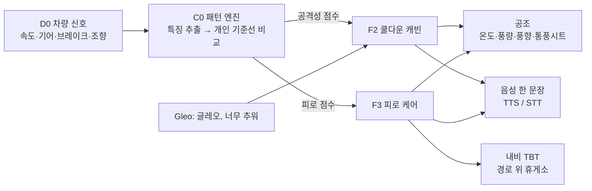

# 쿨다운 코파일럿 (Cooldown Copilot)

> 평소의 나를 학습한 AI가 운전이 거칠어지면 실내를 식혀 주고, 졸음은 실내 공기로 미리 막고 조향으로 잡아 **실제로 쉬게 만드는** 무상호작용 코파일럿.

Pleos Connect(AAOS 기반) 차량용 앱입니다. 현대자동차그룹 차량용 앱 개발 공모전 출품작입니다. 설치 파일과 시연 영상은 [Release v1.1](https://github.com/CoolDownTeam/cooldown-copilot/releases/tag/v1.1)에 있습니다.

---

## 왜 만드나

| 문제 | 숫자 | 출처 |
|---|---|---|
| 고속도로 사망사고의 대부분은 졸음·주시태만 | 2023~2025년 **71.5%** | 한국도로공사 발표 (2026.1) |
| 보복운전은 매년 늘고 있다 | 검찰 송치 2022년 1,570건 → 2025년 **1,726건** | 경찰청 자료 (국회 공개) |
| 공격적 운전은 대다수 운전자가 한다 | 미국 운전자 **78%**가 1년 안에 1회 이상 | AAA Foundation for Traffic Safety (2016) 보고서 |
| 더운 차 안에서는 경계가 떨어진다 | 27℃에서 21℃보다 놓친 신호 **+50%**, 반응 시간 **+22%** | Wyon, Wyon & Norin (1996), *Ergonomics* 39(1) |
| 졸음은 조향에 드러난다 | 졸리면 작은 조향 보정이 줄어든다 | Sahayadhas 외 (2012), *Sensors* 12(12) |
| 졸린 운전자는 자기 졸음을 모르고, 알아도 쉬지 않는다 | "덜 졸리다"고 답한 경우의 **75%**가 실제로 중간 이상 졸림, 매우 졸려도 **75%+**가 계속 운전 | Gaspar & Carney (2023), AAA Foundation |
| 내기순환이 길면 실내 CO2가 쌓인다 | 긴 주행·여러 명 탑승에서 우려 수준, 주기적 외기 혼합 권고 | Hudda & Fruin (2018), *Sci Total Environ* 610–611 |
| 졸음 경고는 이미 의무다 | EU 모든 신차 2024년 7월부터 | Regulation (EU) 2019/2144 부속서 II |

경고음이나 화면 알림은 운전자를 더 자극하거나 무시당하기 쉽습니다. 이 앱은 **운전자가 아무것도 하지 않아도** 차가 먼저 공조를 바꾸고, 필요할 때만 음성 한 문장으로 말합니다.

논문·보고서·법령 원문으로 정리한 근거와 한계(불리한 연구 포함)는 [docs/research.md](docs/research.md)에 있습니다.

---

## 무엇을 하나

| ID | 기능 | 언제 | 운전자 입력 |
|---|---|---|---|
| C0 | **개인 기준선 학습** — 속도대별로 "평소의 나"를 배우고(처음 5회 뒤에도 주행마다 계속 갱신), 지금 운전이 평소와 얼마나 다른지 공격성·피로 점수(0~100)로 계산 | 항상 | 없음 |
| F2 | **쿨다운 캐빈** — 평소보다 거칠어지면 설정 온도를 1~2℃ 낮추고 바람을 한 단계 올렸다가, 진정되면 되돌림. 계절과 사람마다 강도를 따로 학습 | 주행 중 | 없음 ("추워" 한마디로 즉시 복원) |
| F3 | **피로 케어** — ① 내기순환이 길어지면 무음으로 외기 전환(CO2 누적 예방) ② 조향으로 운전자도 모르는 졸음 감지 ③ "응" 한마디면 경로 위 휴게소 입구 전에 알려 주고, 도착하면 커피·낮잠 권유. 찬 바람은 휴게소까지 버티는 보조 | 주행 중 (예방은 항상) | "응/아니" 한마디 |
| F1 | **코스 브리핑** — 출발 전 어려운 구간(연속 분기, 유턴·회전교차로, 정체 진입)을 30초 안에 미리 안내하고, 주행 중에는 1km 전에 한 문장 | 출발 전·주행 중 | 없음 |
| F4 | **주행 리포트** — "평소보다 차분한 주행이었어요"·"오늘은 조금 피곤하셨던 것 같아요", 개입 기록과 효과, 최근 7회 추세 | 도착 후 | 정차 중 터치 |
| S1 | **설정** — 기능별 켜기·끄기, 배운 취향 보기, 운전 습관 다시 배우기 | 정차 중 | 정차 중 터치 |

### 동작 흐름



### 차별점
- **고정 임계값이 아닌 "평소의 나"와 비교** — 같은 급가속이라도 평소 거친 운전자에게는 덜 민감하게 반응합니다. 개인화로 운전 상태 인식 정확도가 81.3%에서 91.6%로 올랐다는 연구(Yi 외, 2019)를 따릅니다.
- **계절·사람별 강도 학습** — 여름엔 온도를 낮추고, 겨울엔 온도는 그대로 둔 채 얼굴 쪽으로만 바람을 보냅니다. "추워"라고 하거나 직접 온도를 올리면 그 계절의 강도를 한 단계 낮춥니다.
- **카메라 없이 차량 신호만** — 조향·가감속 패턴만 씁니다. 원시 센서 로그는 저장하지 않고 차 밖으로 보내지 않습니다.

---

## 운전 안전 원칙

| ID | 원칙 |
|---|---|
| SAFE-01 | 주행 중 화면에는 입력 UI를 두지 않는다 (상태 한 줄만) |
| SAFE-02 | 주행 중 음성은 한 번에 한 문장 |
| SAFE-03 | 운전자가 직접 조작한 설정이 언제나 앱보다 우선한다 |
| SAFE-04 | 지원하지 않는 차량 기능은 미리 확인해서 조용히 끈다 |
| SAFE-05 | 주행 데이터는 차량 밖으로 보내지 않는다 |
| SAFE-06 | 앱 카테고리를 게임으로 두지 않는다 (주행 중 실행 불가) |

---

## 진행 상황

| 기능 | 상태 |
|---|---|
| D0 차량 데이터 계층 | ✅ 완료 |
| C0 패턴 엔진 (특징 추출·기준선 학습·상태 점수·저장) | ✅ 완료 |
| F2 쿨다운 캐빈 (정책·계절 학습·공조·음성·Gleo) | ✅ 완료, 에뮬레이터 확인 |
| F3 피로 케어 (환기·졸음 케어·휴게소 제안·Gleo "응") | ✅ 완료, 에뮬레이터 확인 (시연용 경로) |
| F1 코스 브리핑 | ✅ 완료, 에뮬레이터 확인 (시연용 경로) |
| F4 주행 리포트 · 화면 6종 (SC-01~06) | ✅ 완료 |

단위 테스트 175개. 에뮬레이터 확인 기록은 [docs/feature-spec.md](docs/feature-spec.md) 11.5절에 있습니다.

### 알려진 제약
- 공조 제어 권한(`CONTROL_CAR_CLIMATE`, `CONTROL_CAR_SEATS`)은 Pleos App Market 사전 승인이 필요합니다. 에뮬레이터에서는 이 권한으로 실제 VHAL 공조 값을 바꿔 확인했습니다.
- Gleo 음성 호출은 Pleos 서버에 앱 스키마가 등록돼야 동작합니다. 앱 쪽 수신·응답 경로는 같은 Intent를 `adb`로 보내 에뮬레이터에서 확인했습니다.
- 실제 내비 경로의 휴게소·정체 정보(NaviHelper TBT)는 경로 안내 중에만 와서, 시연은 같은 형식의 시연용 경로(`<시나리오>.route.csv`)로 했습니다. 실차 경로 연동 확인이 남아 있습니다.
- 주행 중 안내 문장은 LLM이 아니라 템플릿입니다. 정해진 순간에 지연 없이, 통신이 끊겨도 나와야 하기 때문입니다 ([기획서](docs/proposal.md) AI 설계).

---

## 기술 스택

| 영역 | 사용 |
|---|---|
| 플랫폼 | Pleos Connect (AAOS), minSdk 28 / targetSdk 36 |
| 언어·UI | Kotlin, Jetpack Compose |
| 비동기 | Coroutines + StateFlow |
| 저장 | Room (KSP) |
| 차량 | Pleos Vehicle SDK 2.0.3, AAOS `CarPropertyManager` (차속·외기온) |
| 내비 | Pleos NaviHelper SDK 2.0.3 |
| 음성 | Pleos TextToSpeech·SpeechToText 3.3.1 (ON_DEVICE), Gleo Interface |
| DI | 수동 DI (`AppContainer`) |

### 구조

```
automotive/src/main/java/com/pleos/cooldown/
  data/          vehicle · hvac · navi · voice · gleo · local(Room) · settings
  domain/        model · engine(C0) · cooldown(F2) · fatigue(F3) · briefing(F1) · report(F4)   ← 순수 Kotlin, JVM 단위 테스트
  service/       CopilotService(포그라운드) · CopilotRunner(주행 한 번을 처음부터 끝까지)
  presentation/  Compose 화면
  di/            AppContainer
```

---

## 빌드·테스트

Android Studio에서 Pleos Connect Emulator(AVD)를 설치한 뒤:

```bash
./gradlew :automotive:assembleDebug -q
```

```bash
./gradlew :automotive:testDebugUnitTest -q
```

```bash
./gradlew :automotive:lintDebug -q
```

### 시연 재생 (debug·demo 빌드)

녹화해 둔 차량 신호를 재생합니다. 앱은 운전자 프로필(사용자 10)에서 돕니다.

```bash
adb shell am start --user 10 -S -n com.pleos.cooldown/.presentation.MainActivity --es scenario f2_aggressive
```

```bash
adb shell am start --user 10 -S -n com.pleos.cooldown/.presentation.MainActivity --es scenario f3_highway
```

- `f2_aggressive`: 거친 운전 13분 → 쿨다운 1·2단계 → 복원 → 리포트
- `f3_highway`: P 브리핑 → 고속도로 약 1시간 → 환기·졸음 케어·휴게소 제안 → 휴게소 정차 (시연용 경로 `f3_highway.route.csv` 사용)

Gleo 응답을 흉내 내려면 (쿨다운 중 "추워" / 휴게소 제안 뒤 8초 안에 "응"):

```bash
adb shell "am broadcast --user current -a ADJUST_CABIN_COMFORT -p com.pleos.cooldown --es ACTION_PARAM '{\"feeling\":\"cold\"}'"
```

```bash
adb shell "am broadcast --user current -a ANSWER_REST_SUGGESTION -p com.pleos.cooldown --es ACTION_PARAM '{\"accept\":true}'"
```

---

## 문서

| 문서 | 내용 |
|---|---|
| [docs/proposal.md](docs/proposal.md) | 기획서 (공모전 양식 02장) |
| [docs/feature-spec.md](docs/feature-spec.md) | 상세 기능명세서 (요구사항 ID, 상태 머신, 수용 기준) |
| [docs/screen-spec.md](docs/screen-spec.md) | 화면 명세 (SC-01~06) |
| [docs/research.md](docs/research.md) | 근거 자료와 한계 |
| [docs/schedule.md](docs/schedule.md) | 개발 일정 |
